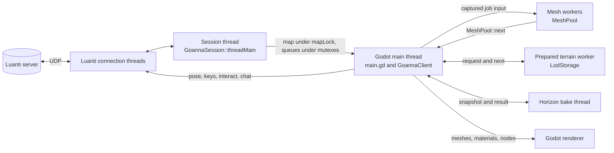

# Architecture

This page is a map of Goanna's code: what runs where, how data gets from a
Luanti server onto the screen, and which file to open for a given change.
Read it before reading the code. It names files and functions so you can
jump straight to them, and it links to the [systems](../systems/index.md)
pages for how each part works in detail rather than repeating them. Where
this page and the code disagree, the code is right; please fix the page.

Goanna is a Godot 4.5 GDExtension that speaks Luanti's own network protocol
to ordinary, unmodified servers. Luanti's client logic does the protocol,
the world state, movement and the meshing rules; Godot does the window, the
scene, the renderer, materials, lighting, sound and the interface.

## The big picture

| Path | What it holds |
|---|---|
| `src/` | The C++ GDExtension, Goanna's own code |
| `src/transplant/` | Luanti files copied in and changed as little as possible |
| `luanti/` | Luanti, a pinned submodule; part of it is compiled straight from here |
| `godot-cpp/`, `whisper.cpp/` | Submodules: the GDExtension bindings, and speech to text |
| `project/` | The Godot project: GDScript, scenes and shaders ([its map](../../project/README.md)) |
| `goanna_server_mod/` | An optional server mod that grants extra capabilities |
| `tools/` | Developer and agent tools ([its index](../../tools/README.md)) |

The extension registers four classes for GDScript
([`register_types.cpp`](../../src/register_types.cpp)): `GoannaClient`, the
whole client; `GoannaIrisEffect`, a shader pack runner; `GoannaRipples`;
and `GoannaSpeechInput`. Almost everything goes through `GoannaClient`.

A running client has these threads:

- **Godot's main thread.** All GDScript, every Godot object, and every
  `GoannaClient` method. `project/game/main.gd` calls the client once or
  more per frame from `_process`.
- **The session thread.** One per connection, started by
  `GoannaSession::start` and running `GoannaSession::threadMain`
  ([`goanna_session.cpp`](../../src/goanna_session.cpp)). It receives and
  handles packets, decodes map blocks into Luanti's own `Map`, and sends
  position updates and block acknowledgements.
- **Luanti's connection threads.** The session uses Luanti's reliable UDP
  layer, compiled from `luanti/src/network/mtp/`, which runs its own send
  and receive threads (`ConnectionSendThread`, `ConnectionReceiveThread`).
  Goanna does not touch them directly.
- **Mesh workers.** A `MeshPool`
  ([`goanna_mesh_pool.h`](../../src/goanna_mesh_pool.h)) of several
  threads that build near block meshes, near regional batches, far region
  meshes and baked surface meshes.
- **The prepared terrain worker.** One `LodStorage` thread
  ([`goanna_lod_storage.h`](../../src/goanna_lod_storage.h)) that reads,
  derives and caches far LOD chains on disk.
- **Short lived threads.** The horizon panorama bake
  (`GoannaClient::horizon_bake_poll` starts one at a time), the item icon
  rasteriser (`ItemIconCache::flush` in
  [`goanna_item_icons.cpp`](../../src/goanna_item_icons.cpp) splits a large
  batch across threads and joins them before returning), and speech
  recognition (`GoannaSpeechInput`, one job at a time).
- **Godot's renderer.** Goanna adds no code here except the Iris
  `CompositorEffect`, whose programs are compiled and drawn on the render
  thread ([`goanna_iris_effect.h`](../../src/iris/goanna_iris_effect.h)).

The main thread sends packets as well as the session thread: calls such as
`GoannaSession::sendInteract` and `sendChat` run on the main thread, and
Luanti's `Connection::Send` queues them for its own send thread.

## Threads and the handoff

### The rule

The session thread and the worker threads never touch Godot objects: no
`Node`, no `Resource` (`ArrayMesh`, `Material`, `Texture2D`, `Image`), no
scene tree. They work on plain C++ and Luanti types, and the main thread
turns their results into Godot objects. The rule is stated in
[`CONTRIBUTING.md`](../../CONTRIBUTING.md), "Code style", and for jobs in
[`goanna_mesh_pool.h`](../../src/goanna_mesh_pool.h): a job must not touch
Godot objects or read live client state, and carries everything it needs,
captured on the main thread when it is made.

Why: Godot's scene and resources belong to the main thread and are not
safe to change from another one, and the session thread runs on its own
clock, so anything it touched would race whatever the frame was doing with
the same object. Keeping every Godot object on one thread also gives one
place where a mesh replaces its predecessor, which is what lets a far
region keep its old mesh until the new one is published.

Godot's packed arrays (`PackedVector3Array` and the rest) are values, not
objects, and the near batch job fills them on a worker (`NearBatchJob` in
[`goanna_client_jobs.cpp`](../../src/goanna_client_jobs.cpp)); the
`ArrayMesh` is made from them on the main thread in
`GoannaClient::nearPublishBatch`.

### From the session to the main thread

Everything the session receives lands in one of two places:

- **The map, under `mapLock()`.** `GoannaSession` keeps Luanti's `Map`
  ([`goanna_map.h`](../../src/goanna_map.h)), the transplanted
  `LocalPlayer`, the active objects, the inventory and the interaction
  state together under one mutex, `m_map_mutex`, exposed as
  `GoannaSession::mapLock()`. The main thread takes it to read blocks
  (`poll_blocks`), step the player (`step_player`), point and dig
  (`step_interact`) and step entities (`sync_entities`). Map changes also
  push block positions onto `m_new_blocks`, which the main thread drains
  with `GoannaSession::takeNewBlocks`.
- **Queues under their own mutexes.** Chat and shown forms
  (`m_hud_mutex`), sounds, particles and dug node bursts (`m_sound_mutex`),
  sky state (`m_sky_mutex`), media (`m_media_mutex`), the player pose
  (`m_pose_mutex`), and server mod options and replies
  (`m_server_opts_mutex`). Each has a `take` method that swaps the vector
  out under the lock, for example `GoannaSession::takeChat`. The
  `GoannaClient` method of the same name (`take_chat`, `take_sounds`,
  `take_shown_formspecs`, `take_particles`) converts the plain structs to
  `Array` and `Dictionary` for GDScript.

The session's plain structs (`ChatLine`, `SoundEvent`,
`ParticleSpawnerEvent`, `NodeDugEvent`, `ShownFormspec` in
[`goanna_session.h`](../../src/goanna_session.h), `SkyState` in
[`goanna_sky.h`](../../src/goanna_sky.h)) are the types that cross.

### From the main thread to the workers

The main thread captures a job's whole input, submits it with
`MeshPool::submit`, and later collects results with `MeshPool::next`. Jobs
are keyed (`MeshJobKey`: near block, LOD region, near batch or surface) and
stamped with a generation, so a newer job replaces a queued one with the
same key, and a result built from data that has since changed is dropped
on collection. Admission and order come from one priority rule shared by
every scheduler, `ViewPriority` in
[`goanna_schedule.h`](../../src/goanna_schedule.h).

| Job | Captured input | Built on the worker |
|---|---|---|
| `NearBlockJob` | a `MeshMakeData` copy of the block and its neighbours (`gatherMeshData`), and a light field | Luanti's `MapBlockMesh` and per vertex light |
| `NearBatchJob` | the member blocks' surfaces | merged packed arrays per material, and occluder triangles |
| `LodRegionJob` | a `LodRegionSnapshot` of the region's LOD chains | a `LodRegionMesh` |
| `SurfaceJob` | baked surface tiles | the surface mesh arrays |

`LodStorage` and the horizon bake follow the same shape with their own
queue and mutex: `LodStorage::request` in, `LodStorage::next` out, and
`horizon_bake_request` and `horizon_bake_poll` for the panorama, whose
snapshot is extracted on the main thread
([`goanna_horizon.h`](../../src/goanna_horizon.h)).

### From the main thread to the session

Settings the session reads are set before `connect_to` or through small
setters (`setContentHold`, `setTextureMap`, `wantedRange`). The player pose
and pressed keys go in through `GoannaSession::setPlayerPose` and
`setPlayerKeys` under `m_pose_mutex`, and the session thread sends them in
its position packets.

## The layers in src

Each file in `src/` starts with a comment saying what it is for; read that
first. Tests sit beside the code as `*_test.cpp`
([testing](testing.md)).

### Session and protocol

[`goanna_session.h`](../../src/goanna_session.h) and
[`goanna_session.cpp`](../../src/goanna_session.cpp): `GoannaSession`, a
Luanti client session with no rendering. It implements Luanti's `IGameDef`
and `con::PeerHandler`, so Luanti's node and item definition managers,
`MapBlock` and inventory code work against it unchanged. `threadMain` runs
the connection, `handle` dispatches each packet to an `on...` handler
transplanted from `Client::handleCommand_*`, and `SessionState` tracks the
handshake from `Connecting` to `Ready`. It also owns the `goanna:v1` mod
channel to the server mod (`joinGoannaChannel`, `onModChannelMsg`), the
transplanted movement step (`stepPlayer`), and pointing and digging
(`stepInteract`). See [protocol coverage](../systems/protocol-coverage.md)
for what each packet does and how GDScript reads it.

### The GDExtension surface

[`goanna_client.h`](../../src/goanna_client.h) and
[`goanna_client.cpp`](../../src/goanna_client.cpp): `GoannaClient`, a
`Node3D` that owns one `GoannaSession` and everything drawn from it. Every
method GDScript can call is registered in `GoannaClient::_bind_methods`, in
`goanna_client.cpp` with the connection, the plain settings and
`render_stats`. The main groups are:

- connection and status: `connect_to`, `disconnect_from_server`, `status`;
- the per frame steps: `poll_blocks`, `update_lod`, `step_player`,
  `step_interact`, `sync_entities`, `update_lights`, `step_node_animation`;
- data for the interface: `take_*`, `hud_state`, `inventory_state`,
  `item_icon`, `texture`, `sky_state`;
- settings: the `set_*` methods, mostly mirrored from `project/game/`.

The rest of the class is in one file per area, named in the sections
below; the list is also at the top of `goanna_client.cpp`. The files share
their includes and a few helpers through
[`goanna_client_internal.h`](../../src/goanna_client_internal.h).

- [`goanna_client_player.cpp`](../../src/goanna_client_player.cpp): the
  local player (`step_player`, `set_player_pose`), pointing and digging
  (`step_interact`), the wielded item, the entity renderer hookup, and the
  map queries GDScript asks (`node_name_at`, `ground_height` and the
  rest).
- [`goanna_client_interface.cpp`](../../src/goanna_client_interface.cpp):
  chat, the HUD, inventories and item icons, forms, sounds, particles,
  media, and the overseer view.
- [`goanna_client_jobs.cpp`](../../src/goanna_client_jobs.cpp): the three
  mesh job types, what captures and submits them, and `lodCollectMeshes`,
  which takes every finished job back. It is the only part of
  `GoannaClient`'s code that runs on a worker.

`GoannaClient::render_stats` reports where the client's time goes, which
the control channel and benchmarks read.

### The map, the store and near meshing

- [`goanna_map.h`](../../src/goanna_map.h): Luanti's own `Map`, with
  sectors created as blocks arrive.
- [`goanna_mesher.h`](../../src/goanna_mesher.h): meshing on top of
  Luanti's `MapBlockMesh`, split into `gatherMeshData` (reads the map,
  under the lock) and `meshGathered` (runs on a worker). Output is Irrlicht
  CPU mesh buffers, which `GoannaClient::poll_blocks` converts to Godot
  arrays.
- [`goanna_luanti_client.h`](../../src/goanna_luanti_client.h): the
  stand-in `Client` that the transplanted meshing code calls.
- [`goanna_store.h`](../../src/goanna_store.h): `BlockStore`, every block
  the server sent, on disk, one directory per server, written as blocks
  arrive in `GoannaSession::onBlockData`.
- In [`goanna_client_near.cpp`](../../src/goanna_client_near.cpp):
  `poll_blocks` drains new blocks nearest and most visible first, and
  `nearAssign` and `nearPublishBatch` merge finished blocks into regional
  batches by material. `nearSubmit`, which hands a block to the workers,
  and `nearRebuild`, which submits a dirty batch, are in
  [`goanna_client_jobs.cpp`](../../src/goanna_client_jobs.cpp).

See [mesh attributes](../systems/mesh-attributes.md) for the vertex layout
every terrain mesh carries, and
[animated node tiles](../systems/node-animation.md).

### The far field and LOD

- [`goanna_lod.h`](../../src/goanna_lod.h): a chain of coarser levels per
  mapblock (cells of 1, 2, 4, 8 and 16 nodes) and the per region tier
  mesher that works from chains alone.
- [`goanna_lod_storage.h`](../../src/goanna_lod_storage.h): prepared chain
  records on disk and the `LodStorage` worker.
- [`goanna_occlusion.h`](../../src/goanna_occlusion.h): the voxel
  occupancy and ambient occlusion tracer, shared by near and far.
- [`goanna_schedule.h`](../../src/goanna_schedule.h): the one priority
  rule all the build queues share.
- [`goanna_horizon.h`](../../src/goanna_horizon.h): the horizon panorama
  beyond the drawn far field.
- [`goanna_surface.h`](../../src/goanna_surface.h) and
  [`goanna_fine.h`](../../src/goanna_fine.h): baked surface tiles and fine
  node data, both sent by the server mod.
- In [`goanna_client_lod.cpp`](../../src/goanna_client_lod.cpp):
  `update_lod` retiers blocks as the player moves, takes server summaries
  and requests more, and publishes finished regions (`lodPublishRegion`);
  `lodRebuild`, at the end of `poll_blocks`, picks the dirty regions to
  capture for the workers.
- In [`goanna_client_far.cpp`](../../src/goanna_client_far.cpp): the far
  field beyond the live map. `lodUpdateFar` draws stored blocks within the
  granted distance, `lodRequestSummaries` and `lodTakeSummaries` ask the
  server mod for summaries and read them, and `horizon_bake_request` and
  `horizon_bake_poll` make the horizon panorama.
- In [`goanna_client_jobs.cpp`](../../src/goanna_client_jobs.cpp):
  `lodBuildRegion` captures a region for its job, and `lodCollectMeshes`
  takes finished regions back.
- In [`goanna_client_surface.cpp`](../../src/goanna_client_surface.cpp)
  and [`goanna_client_fine.cpp`](../../src/goanna_client_fine.cpp): the
  main thread side of baked surface tiles and fine node data.

See [far rendering](../systems/far-rendering.md),
[prepared terrain storage](../systems/terrain-storage.md),
[terrain surfaces](../systems/terrain-surface.md) and
[baked terrain](../systems/baked-terrain.md).

### Materials and textures

- [`goanna_textures.h`](../../src/goanna_textures.h): the texture and
  shader sources the transplanted code asks for. `GoannaTextureSource`
  runs Luanti's own texture modifier language (`ImageSource`) on CPU
  images, with Godot decoding the media
  ([`goanna_image_hooks.h`](../../src/goanna_image_hooks.h)).
- [`goanna_materials.h`](../../src/goanna_materials.h): the per node
  classifier, a material class and a Minecraft block for each node.
- [`goanna_overlay_companions.h`](../../src/goanna_overlay_companions.h)
  and [`goanna_texture_size.h`](../../src/goanna_texture_size.h): LabPBR
  companions for composed textures, and the texture resolution cap.
- [`goanna_lava.h`](../../src/goanna_lava.h) and
  [`goanna_flame.h`](../../src/goanna_flame.h): the special surfaces.
- In [`goanna_client_materials.cpp`](../../src/goanna_client_materials.cpp):
  `keyForIrr` turns a Luanti material into a `MaterialKey`, and
  `materialFor` builds and caches the Godot material for it, from the
  shaders in `project/shaders/` (`nodes_array.gdshader` for most terrain).
  Animated node tiles (`step_node_animation`) are there too.

See [materials](../systems/materials.md), and the
[lava](../systems/lava-material.md), [fire](../systems/fire-material.md),
[ice](../systems/ice-rendering.md), [portal](../systems/portal-materials.md)
and [water](../systems/water-optics.md) pages.

### Entities

Players, mobs and dropped items are active objects. Their state is
Luanti's: `GoannaActiveObject`, the state half of `GenericCAO`,
transplanted in
[`src/transplant/client/content_cao.h`](../../src/transplant/client/content_cao.h)
and stepped by `GoannaSession::stepObjects`. Drawing them is Goanna's:

- [`goanna_entities.h`](../../src/goanna_entities.h): `EntityRenderer`,
  sprites, cubes, meshes, nametags and attachments in the scene;
- [`goanna_models.h`](../../src/goanna_models.h): Luanti's model loaders
  behind a stub scene manager, conversion to `ArrayMesh` with bones, and
  the animator;
- [`goanna_animation.h`](../../src/goanna_animation.h),
  [`goanna_limbs.h`](../../src/goanna_limbs.h) and
  [`goanna_upright_sprite.h`](../../src/goanna_upright_sprite.h).

`GoannaClient::sync_entities`, in
[`goanna_client_player.cpp`](../../src/goanna_client_player.cpp), takes the
map lock, steps the objects and calls `EntityRenderer::sync`. See the
[first person body](../systems/first-person-body.md) and
[knees, elbows and strokes](../systems/limbs.md).

### Light

- Vertex light and ambient occlusion:
  [`goanna_light.h`](../../src/goanna_light.h). Luanti bakes light into
  vertex colour; Goanna turns that off (`g_goanna_no_light`, in
  [`goanna_mesh_flags.h`](../../src/goanna_mesh_flags.h)) and writes light
  into its own attribute, because Godot lights the scene and would
  otherwise light it twice.
- Node lights: `GoannaClient::harvestLights` notes bright nodes as blocks
  are meshed, and `update_lights` keeps a budget of `OmniLight3D`s on the
  nearest, both in
  [`goanna_client_light.cpp`](../../src/goanna_client_light.cpp) with the
  ambient motes and `sky_state`.
- Sky, sun and fog: [`goanna_sky.h`](../../src/goanna_sky.h) decodes what
  the server sent; `sky_state` hands it to `main.gd`'s `_apply_sky` and
  [`sky_director.gd`](../../project/game/effects/sky_director.gd).

See [mesh attributes](../systems/mesh-attributes.md),
[sky orchestration](../systems/sky-orchestration.md) and
[graphics tiers](../systems/graphics-tiers.md).

### Iris shader packs

`src/iris/` loads an Iris or OptiFine shader pack
([`iris_pack.h`](../../src/iris/iris_pack.h)), translates its GLSL for
Vulkan ([`iris_glsl.h`](../../src/iris/iris_glsl.h)), and runs its screen
space programs as a `CompositorEffect`
([`goanna_iris_effect.h`](../../src/iris/goanna_iris_effect.h)). The
gbuffers programs are not run. `main.gd` loads a pack when
`GOANNA_SHADERPACK` names one. See [Iris shader packs](../design/iris-compat.md)
and [shader pack testing](shaderpack-testing.md).

### Transplanted Luanti code

Luanti code reaches Goanna in three ways, in this order of preference:

1. **Compiled from the submodule, untouched.**
   [`cmake/luanti_core.cmake`](../../cmake/luanti_core.cmake) builds a
   subset of `luanti/src` into the `luanti_core` static library: the
   network layer, serialisation, node and item definitions, `MapBlock` and
   `Map`, inventory, authentication, the raycast, and Irrlicht's CPU only
   image and model code.
2. **Given a stand-in.** Where upstream code needs something Goanna does
   not have, Goanna supplies a class with the name upstream expects:
   `Client` in [`goanna_luanti_client.h`](../../src/goanna_luanti_client.h),
   the image hooks in [`goanna_image_hooks.h`](../../src/goanna_image_hooks.h).
3. **Copied into `src/transplant/`.** Files that reach for Irrlicht's
   renderer or for `Client` itself: the block mesher
   (`client/mapblock_mesh.cpp`, `content_mapblock.cpp`,
   `node_visuals.cpp`), the image source, the active object, the wield
   mesh and item visuals, the movement code (`localplayer.cpp`,
   `collision.cpp`) and the raycast. They keep Luanti's style and headers
   and are never restyled. [`luanti_shims.cpp`](../../src/luanti_shims.cpp)
   holds a few verbatim pieces of server only files the core needs.

`luanti/` itself is never patched. The rules, and the inventory of every
copied file, are in [transplanting Luanti code](transplanting.md).

### Smaller pieces

- [`goanna_item_icons.h`](../../src/goanna_item_icons.h) and
  [`goanna_icon_raster.h`](../../src/goanna_icon_raster.h): inventory
  icons for node items, drawn as upstream draws them, on the CPU.
- [`goanna_raycast.h`](../../src/goanna_raycast.h): the transplanted
  pointed thing raycast.
- [`goanna_radial_form.h`](../../src/goanna_radial_form.h) and
  [`goanna_mining_cycle.h`](../../src/goanna_mining_cycle.h): the shape of
  a partly dug node and the clock of a dig.
- [`goanna_ripples.h`](../../src/goanna_ripples.h): `GoannaRipples`, the
  water around the eye ([weather](../systems/weather.md), "Ripples").
- [`goanna_grass.h`](../../src/goanna_grass.h): the optional
  [procedural grass](../systems/procedural-grass.md).
- [`goanna_render_scope.h`](../../src/goanna_render_scope.h): per player
  shader globals for [local multiplayer](../systems/local-multiplayer.md).
- [`goanna_speech_input.h`](../../src/goanna_speech_input.h):
  `GoannaSpeechInput`, voice typing through whisper.cpp.

## The GDScript layer

The Godot project's folders are mapped in
[`project/README.md`](../../project/README.md). The parts a newcomer meets
first:

| Where | What |
|---|---|
| `project/menu/menu.gd` | The main scene: start a local game or join a server |
| `project/game/main.gd`, `main.tscn` | The game scene, which owns the `GoannaClient` |
| `project/game/local_play.gd` | Split screen: one game scene per player slot |
| `project/net/local_server.gd` | Running a Luanti server on this machine |
| `project/ui/game_ui.gd`, `formspec.gd` | HUD, chat, inventory, and server forms |
| `project/game/effects/` | Sky, clouds, weather, particles, water and wakes |
| `project/shaders/` | Every world shader |
| `project/agents/` | The control channel and the player agent channel |
| `project/input/gamepad.gd` | Controllers; the one autoload, `Gamepad` |

### From the menu to a session

`run/main_scene` in `project/project.godot` is `res://menu/menu.tscn`. For
a local game the menu starts a Luanti server through `local_server.gd` and
waits for it; to join, it takes the address from the form. Either way it
sets the `GOANNA_*` environment variables (`GOANNA_HOST`, `GOANNA_PORT`,
`GOANNA_NAME`, `GOANNA_PACK` and others) and calls `_go_to_game`, which
changes scene to `res://game/main.tscn`, or to `local_play.tscn` when there
is more than one local player.

`main.gd`'s `_ready` reads those variables and the saved settings in
`user://goanna.cfg`, creates `GoannaClient.new()`, adds it and the
interface (`ui/game_ui.tscn`) to the scene, builds the camera, lights and
environment, and calls `client.connect_to(...)`. With `GOANNA_CONTROL` set
it also adds the control channel. Starting Godot with `GOANNA_HOST` already
set skips the menu, which is how the tools start test clients.

### The game scene

`main.gd`'s `_process` drives the client in a fixed order each frame:
`step_node_animation`, the sky (`_apply_sky`), `status` for the connection
overlay, then movement: `step_player` and `step_interact` when walking, or
`set_player_pose` for the free flying camera. After that come
`poll_blocks`, `prune_blocks` every two seconds,
`update_lights`, `update_motes`, `update_lod`, `sync_entities`, and the
environment and wield updates. Other nodes read their own queues:
`game/audio.gd` takes sounds, `game/effects/particles.gd` takes particles
and dug node bursts, and `ui/game_ui.gd` takes chat and forms and reads
`hud_state` and `inventory_state`.

The formspec renderer, `ui/formspec.gd`, is a GDScript rewrite of
`GUIFormSpecMenu`'s layout rules, not a transplant. See
[interface style](../systems/interface-style.md) and
[formspec conformance](formspec-conformance.md).

## The life of a session

A walk from joining to digging a node, naming the functions on the way.

### Connecting

1. `main.gd` calls `GoannaClient::connect_to`, which clears what the last
   session left, makes a `GoannaSession`, and calls
   `GoannaSession::start`. That opens the block store and starts the
   session thread. `connect_to` then starts the `MeshPool`.
2. On the session thread, `threadMain` connects and sends `TOSERVER_INIT`
   (`sendInit`). `onHello`, `startAuth`, `onSrpBytesSB` and `onAuthAccept`
   carry the handshake and SRP login.
3. `onNodeDef`, `onItemDef`, `onAnnounceMedia` and `onMedia` collect the
   content. When everything has arrived, `maybeReady` sets
   `SessionState::ContentReady`.
4. On the main thread, `poll_blocks` calls
   `GoannaSession::prepareContentIfReady`. It loads the media and any
   texture pack into the texture source, fills Luanti's node visuals
   (`NodeVisuals::fillNodeVisuals`), builds the material table and the
   animation arrays, and sets a flag. It runs on the main thread because
   Godot decodes the media images
   ([`goanna_image_hooks.h`](../../src/goanna_image_hooks.h)).
   `setContentHold` can hold it while material bundles download.
5. The session thread sees the flag, sends `TOSERVER_CLIENT_READY`
   (`sendReady`), reaches `SessionState::Ready` and joins the `goanna:v1`
   channel. If the server mod answers, its options arrive in
   `onModChannelMsg`.

### The first blocks on screen

1. `TOCLIENT_BLOCKDATA` arrives. `GoannaSession::onBlockData`, under the
   map lock, deserialises the block into the map, queues it and its
   neighbours with `queueBlockUpdate`, and queues an acknowledgement. Out
   of the lock it writes the bytes to the store. `threadMain` sends the
   acknowledgements (`sendGotBlocks`) and the player position
   (`sendPlayerPos`).
2. Next frame, `poll_blocks` takes the map lock and the new blocks
   (`takeNewBlocks`), orders them with `ViewPriority`, and, within a time
   budget (6 ms by default), calls `nearSubmit` for each: `gatherMeshData`
   copies the block and its neighbours, and a `NearBlockJob` goes to the
   pool. Blocks beyond the near distance go to their far region instead
   (`lodAssign`).
3. On a worker, `NearBlockJob::run` meshes the copy with Luanti's
   `MapBlockMesh` (`meshGathered`) and samples vertex light.
4. `update_lod` calls `lodCollectMeshes`, which moves finished near blocks
   into `m_near_ready`. The next `poll_blocks` converts each into Godot
   arrays by material (`NearSurface`), notes its lights, and calls
   `nearAssign` to mark its region dirty.
5. `nearRebuild`, at the end of `poll_blocks`, submits a `NearBatchJob`
   for each dirty region. When it returns, `nearPublishBatch` builds the
   `ArrayMesh`, binds materials from `materialFor`, and swaps it onto the
   region's `MeshInstance3D` with its occluder. Godot draws it next frame.

Far terrain runs the same way at a coarser grain: `lodRebuild` captures
regions into `LodRegionJob`s, and `lodCollectMeshes` publishes them with
`lodPublishRegion`.

### Digging a node

1. `main.gd` calls `step_interact` every frame with the button state.
   `GoannaClient::step_interact` takes the map lock and calls
   `GoannaSession::stepInteract`.
2. `stepInteract` casts the pointing ray with the transplanted
   `continueRaycast`, works out the dig time from the tool's capabilities,
   and sends `INTERACT_START_DIGGING`. As the dig goes on it raises the
   crack level and queues that block with `queueBlockUpdate`. The next
   `poll_blocks` remeshes it inline with `meshBlock`, not on a worker,
   because the crack needs the texture source.
   Burst events go into `m_dug_nodes` for `particles.gd`.
3. When the dig completes it predicts the result as Luanti's client does
   (`removeNodeAndUpdate`, or the node's `node_dig_prediction`), queues the
   affected blocks (`queueBlocksAround`), and sends
   `INTERACT_DIGGING_COMPLETED`.
4. The server decides. A dig it accepts comes back as a node change,
   `TOCLIENT_REMOVENODE` or `TOCLIENT_ADDNODE`, handled by `onRemoveNode`
   or `onAddNode`; a dig it refuses makes it send the block again
   (`SetBlockNotSent` in Luanti's `serverpackethandler.cpp`), which arrives
   through `onBlockData`. Either way the session thread updates the map
   and queues the blocks, and the next `poll_blocks` remeshes them as
   above.

## Outside the client

### The server mod

[`goanna_server_mod/`](../../goanna_server_mod/README.md) is optional. A
server without it renders as any vanilla client renders it; the mod only
grants. It talks over the `goanna:v1` mod channel, which the session joins
after `CLIENT_READY`. It relays every `goanna_*` setting as an option the
client reads (`GoannaClient::server_options`, for example the far
rendering grant), and its submods answer requests: far summaries
(`far_summary.lua`), fine node data (`fine.lua`), baked surfaces
(`surface.lua`), shared dig damage (`damage.lua`), remembered dig progress
(`dig_progress.lua`), and the director (`director/`). The client takes
grants and terrain only from messages the server itself sent, never from
another player on the channel (the empty sender test in
`GoannaSession::onModChannelMsg`). Operators set
it up through [hosting](../host/index.md); the boundaries it keeps are in
[capabilities](../design/capabilities.md).

### The control channel and agents

With `GOANNA_CONTROL` set, `main.gd` adds
[`project/agents/control_channel.gd`](../../project/agents/control_channel.gd),
a loopback socket that runs commands inside the client. `tools/goanna-mcp`
and `tools/goanna-control` talk to it. The player agent channel
(`player_agent_channel.gd`) is a separate, narrower interface for an agent
playing the game. Start with the [agents section](../agents/index.md):
[agent interfaces](../agents/agent-interfaces.md),
[the control channel](../agents/control-channel.md) and
[the director](../agents/director.md).

### Tools

[`tools/README.md`](../../tools/README.md) lists every tool. The ones a
developer meets first: `tools/goanna-headless` starts test clients off the
desktop and guards the GPU, `tools/goanna-render` takes rendered frames,
`tools/check-style.sh` is the text style gate, and `tools/docs/` builds
this site. The rules for running clients are in
[agent interfaces](../agents/agent-interfaces.md), "Rules for test
clients".

## Where to start

| I want to change | Start in |
|---|---|
| How a packet is handled, or handle a new one | `GoannaSession::handle` and its `on...` handlers in `src/goanna_session.cpp`; [protocol coverage](../systems/protocol-coverage.md) |
| What GDScript can call | `src/goanna_client.h`, and `GoannaClient::_bind_methods` |
| Movement and collision | `GoannaSession::stepPlayer`, `src/transplant/localplayer.cpp`, `collision.cpp` |
| Pointing, digging, placing | `GoannaSession::stepInteract` |
| How a node is meshed | `src/goanna_mesher.cpp`, `src/transplant/client/content_mapblock.cpp` (upstream's rules; see [transplanting](transplanting.md) first) |
| Vertex data on terrain | `GoannaClient::poll_blocks`, `src/goanna_lod.cpp`; [mesh attributes](../systems/mesh-attributes.md) |
| Which block is built first | `src/goanna_schedule.h` |
| Far terrain | `GoannaClient::update_lod`, `lodTierFor`, `src/goanna_lod.cpp`; [far rendering](../systems/far-rendering.md) |
| A terrain material or shader | `GoannaClient::materialFor`, `src/goanna_materials.cpp`, `project/shaders/nodes_array*.gdshader`; [materials](../systems/materials.md) |
| Mobs, players and items | `src/goanna_entities.cpp`, `src/goanna_models.cpp` |
| Sky, fog and the sun | `main.gd` `_apply_sky`, `project/game/effects/sky_director.gd`; [sky orchestration](../systems/sky-orchestration.md) |
| Weather and water | `project/game/effects/`; [shader weather](../systems/weather.md), [water optics](../systems/water-optics.md) |
| Graphics presets and switches | `project/game/graphics_profiles.gd`, `render_features.gd`; [graphics tiers](../systems/graphics-tiers.md) |
| HUD, inventory and forms | `project/ui/game_ui.gd`, `project/ui/formspec.gd` |
| The main menu | `project/menu/menu.gd` |
| A control channel command | `project/agents/control_channel.gd`; [control channel](../agents/control-channel.md) |
| Something the server must grant | `goanna_server_mod/`, then read it with `server_options` |
